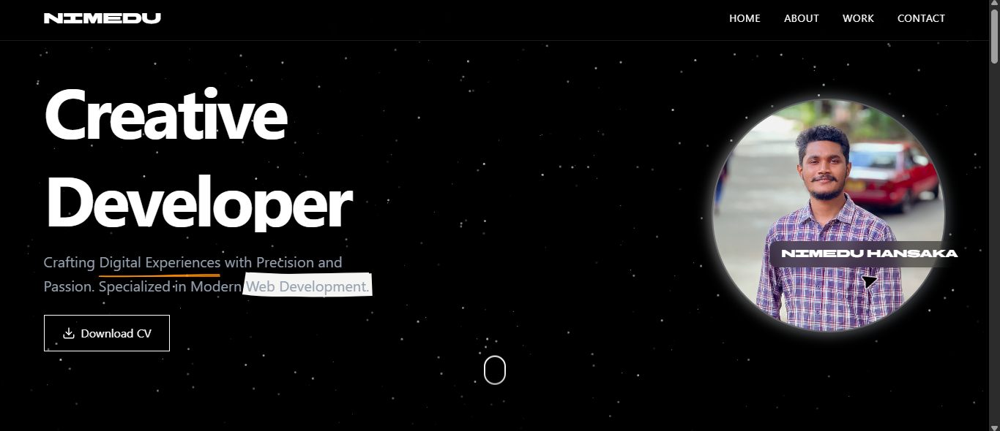

# Next.js Portfolio

A modern, responsive developer portfolio built with **Next.js**, designed to showcase projects, skills, experience, and contact information in a clean and performant interface. This repository can serve as both your personal website and a template for others who want to quickly spin up a professional portfolio.

## ✨ Features

- **Next.js + React** front-end
- **Responsive design** for desktop, tablet, and mobile
- **SEO-friendly** with meta tags and social sharing previews
- **Reusable components** for sections like:
  - Hero / Introduction
  - About
  - Skills / Tech Stack
  - Projects / Case Studies
  - Experience / Timeline
  - Contact / Call-to-Action
- **Optimized images** using Next.js `Image` component 
- **Fast performance** with static generation / server-side rendering 
- Easily customizable **theme, colors, and content**

---

## 🏗️ Tech Stack

- **Framework:** [Next.js](https://nextjs.org/)
- **Language:** JavaScript 
- **UI / Styling:** Tailwind CSS, CSS Modules, Styled Components
- **Deployment:** Cloudflare

---

## 📁 Project Structure

```bash
.
├── public/             # Static assets (images, icons, etc.)
├── src/ or pages/      # Application pages and routes
│   ├── index.tsx       # Home / main portfolio page
│   ├── about.tsx       # About page 
│   ├── projects.tsx    # Projects listing 
│   └── api/            # API routes 
├── components/         # Reusable React components
├── styles/             # Global and component styles
├── package.json
├── next.config.js
└── README.md
```

---

## 🚀 Getting Started

Follow these steps to run the project locally.

### 1. Clone the repository

```bash
git clone https://github.com/nimeduhansaka/Next.js-Portfolio.git
cd Next.js-Portfolio
```

### 2. Install dependencies

Using **npm**:

```bash
npm install
```

Or with **yarn**:

```bash
yarn
```

### 3. Run the development server

```bash
npm run dev
# or
yarn dev
```

Open [http://localhost:3000](http://localhost:3000) in your browser to see the portfolio.

---


---

## 🧩 Customization

You can customize this portfolio by editing:

- **Profile information** – name, title, summary, social links
- **Sections** – enable/disable or reorder components like About, Projects, Skills, etc.
- **Content data** – project details, skills list, experience timeline
- **Theme** – colors, fonts, light/dark mode


Common places to change content include:

- A config file like `config/site.ts` or `data/*.ts`
- Section components in `components/`
- Page files in `pages/` or `app/`


---

## 📦 Scripts

Document the most important `package.json` scripts :

```json
{
  "scripts": {
    "dev": "next dev",
    "build": "next build",
    "start": "next start",
    "lint": "next lint"
  }
}
```

- `npm run dev` – Start development server
- `npm run build` – Build the production application
- `npm run start` – Run the production build
- `npm run lint` – Run lint checks

---

## 📸 Screenshots





---

## 🌐 Deployment

### Cloudflare Workers

Use `npm run build` as the build command and `npx wrangler deploy` as the
deploy command. Without a Wrangler configuration file, Wrangler automatically
configures the project for Workers.

If deployment reports that Next.js `14.2.33` cannot be automatically configured,
deploy the latest revision of your connected branch. Commit `41f49f5` updates
both `package.json` and `package-lock.json` to Next.js `14.2.35`, the minimum
version required by the Wrangler version in that error.

1. Ensure the Cloudflare production branch includes that commit.
2. Start a new deployment of the latest commit instead of retrying the old revision.
3. Check that the build log shows `Next.js 14.2.35` or newer. If it still shows
   `14.2.33`, verify the connected repository, branch, and root directory, then
   clear the build cache and deploy again.

To verify the locked dependency and production build locally:

```bash
npm ci
npm ls next
npm run build
```

You can deploy this Next.js portfolio easily using platforms like:

- [Vercel](https://vercel.com/) – first-class Next.js support
- [Netlify](https://www.netlify.com/)
- [Cloudflare](https://www.cloudflare.com/)


Typical Vercel deployment steps:

1. Push your code to GitHub.
2. Go to Vercel, import the repository.
3. Configure the project (build command usually `next build`, output `.next`).
4. Set any required environment variables.
5. Deploy and connect your custom domain if desired.

---

## 🤝 Contributing

Contributions, issues, and feature requests are welcome.

1. Fork the repository
2. Create your feature branch:  
   `git checkout -b feature/awesome-feature`
3. Commit your changes:  
   `git commit -m "Add awesome feature"`
4. Push to the branch:  
   `git push origin feature/awesome-feature`
5. Open a Pull Request

---

## 📝 License

This project is licensed under the **MIT License** – see the [LICENSE](LICENSE) file for details.

---

## 👤 Author

**Nimedu Hansaka**

- GitHub: [nimeduhansaka](https://github.com/nimeduhansaka)
- LinkedIn: [Nimedu](https://www.linkedin.com/in/nimedu-hansaka-9721b4383)

If you use this template or find it helpful, consider giving the repository a ⭐ on GitHub!
